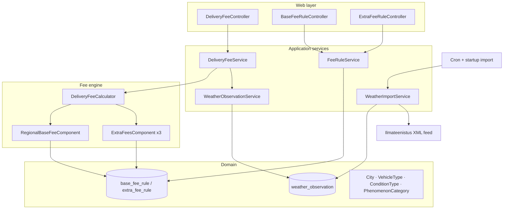

# Delivery Fee Service

A Spring Boot service that hourly imports Estonian weather data for three stations, stores it
append-only, calculates delivery fees from **data-driven** business rules, and exposes a
documented REST API with full CRUD over the rules and a historical `datetime` mode.

> Fujitsu Java Programming Trial Task 2026 — *"Do less, but show best."*

## Highlights

- **Data-driven rules** — regional base fee + weather extra fees live in the database with
  half-open validity windows `[valid_from, valid_to)`, so the *same* endpoint answers both
  "what's the fee now?" and "what was the fee last winter?".
- **OOP-first fee engine** — composite + strategy components over `if`-chains; forbidden
  conditions are data, not code.
- **Hardened integration** — the weather XML feed is parsed with XXE/DTD protection; timeouts
  bound the worst case; the import is idempotent and append-only.
- **RFC 9457 errors** — every failure becomes a `application/problem+json` `ProblemDetail`.

## Architecture



Package layout (feature-based): `common` (shared vocabulary, errors), `weather` (import +
observation store), `rules` (entities + CRUD), `delivery` (fee engine + endpoint). Dependency
direction: `delivery → {rules, weather}`, everything depends on `common`; no cycles.

## Quickstart

```bash
./mvnw spring-boot:run
```

- Swagger UI: <http://localhost:8080/swagger-ui.html>
- OpenAPI JSON: <http://localhost:8080/v3/api-docs>
- Health: <http://localhost:8080/actuator/health>

On startup the app performs a **best-effort weather import** (failures are logged, never block
boot). The H2 database is stored in `./data/` (file mode), so history survives restarts.

**Demo historical data (dev profile):** run with `./mvnw spring-boot:run
-Dspring-boot.run.profiles=dev` to also seed a few past observations (winter snow 2024-01-15 and a
summer storm 2024-07-15) plus the H2 console at `/h2-console`. This lets you exercise the
historical `datetime` endpoint immediately.

### Demo curls

```bash
# Current fee for a delivery in Tartu by bike
curl 'http://localhost:8080/api/v1/delivery-fee?city=TARTU&vehicleType=BIKE'

# Historical fee for the same delivery in January 2024
curl 'http://localhost:8080/api/v1/delivery-fee?city=TARTU&vehicleType=BIKE&datetime=2024-01-15T12:00:00Z'

# List and create rules
curl http://localhost:8080/api/v1/rules/base-fees
curl -X POST http://localhost:8080/api/v1/rules/base-fees \
  -H 'Content-Type: application/json' \
  -d '{"city":"TARTU","vehicleType":"BIKE","fee":3.00,"validFrom":"1990-01-01T00:00:00Z","validTo":"1995-01-01T00:00:00Z"}'
```

A ready-to-run script with more examples is in [`scripts/demo.sh`](scripts/demo.sh).

## Test

```bash
./mvnw verify   # unit + integration tests, Spotless formatting check, JaCoCo coverage gate
```

Coverage is enforced at ≥ 70% instruction (currently ~94%) on `com.deliveryfee.*`. The test
suite includes boundary matrices for the numeric matcher, phenomenon precedence, the spec
example (Tartu + bike = 4.00), XXE rejection, import idempotency, and historical-datetime
integration tests.

## Security notes

| Threat | Mitigation |
|---|---|
| XXE / entity expansion | `XmlMapper` with `SUPPORT_DTD=false`, external entities disabled; tested with a malicious DTD |
| SQL injection | Derived queries + parameterized JPQL only; no native/string SQL |
| Mass assignment | DTOs in/out; entities never bound or returned |
| Information disclosure | `ProblemDetail` with fixed messages; stack traces logged server-side only |
| SSRF | Import URL from validated config only (HTTPS); never from request input |
| Resource exhaustion | Connect/read timeouts; only the 3 needed stations are mapped |
| Supply chain | Versions managed by the Spring Boot BOM only; OWASP dependency-check is a documented follow-up |

Explicit non-goal: authentication/authorization (out of task scope; noted as production follow-up).

## Decision log

1. **H2 file mode** — history must survive restarts.
2. **Rules in DB with half-open validity windows** — CRUD + historical calculation require
   data-driven, time-aware rules; `[from, to)` avoids boundary ambiguity.
3. **One generic `extra_fee_rule` table + one `ExtraFeesComponent`** — three conditions, one
   mechanism; a fourth condition needs only new rows.
4. **`BigDecimal` scale 2 for money** — never `double`/`float`.
5. **`Instant`/UTC everywhere** — no timezone ambiguity in stored history.
6. **`RestClient` over `WebClient`** — synchronous batch import; reactivity adds no value.
7. **Composite + strategy over `if`-chains** — each fee source independently testable.
8. **Flyway over `data.sql`** — versioned, reviewable migrations.
9. **MockWebServer + recorded real XML over Testcontainers** — no Docker, tests pinned to reality.
10. **Feature packages over layers-per-package** — matches the domain, limits sprawl.
11. **No caching layer** — indexed H2 queries are fast at this scale; correctness first.
12. **`@Primary` JSON `ObjectMapper` + hardened `XmlMapper` bean** — keeps JSON/XML serialization
    separate (an `XmlMapper` is an `ObjectMapper`, so it must not shadow the JSON mapper).

## Requirement → implementation mapping

| Requirement | Implementation | Verified by |
|---|---|---|
| Hourly weather import (3 stations) | `WeatherImportJob` (cron + startup) → `WeatherImportService` | `WeatherImportServiceTest` (MockWebServer) |
| Append-only, idempotent storage | `UNIQUE(station, observed_at)` + latest-per-station skip | re-run test asserts zero duplicates |
| Data-driven rules | Flyway `V1__schema.sql` + `V2__seed_rules.sql` (9 base + 12 extra) | fee engine + integration tests |
| Spec example Tartu + bike = 4.00 | Composite fee engine over seeded rules | `DeliveryFeeCalculatorTest` + integration test |
| Documented REST API | springdoc Swagger UI + OpenAPI JSON | `openApiJsonIsGenerated` |
| Rules CRUD | `BaseFeeRuleController` / `ExtraFeeRuleController` → `FeeRuleService` | `RulesControllerTest`, `FeeRuleServiceTest` |
| Overlap → 409 | `IntervalUtils.overlaps` + `ExtraFeeRule.overlapsCondition` | service + controller tests |
| Historical `datetime` | half-open validity windows + `observed_at <= at` lookup | `historicalDatetime_usesOlderObservationAndOlderRuleVersion` |
| Future time → 400 | `@PastOrPresent` on the endpoint | controller + integration tests |
| No data at/before time → 422 | `WeatherObservationService.latestFor` | controller + integration tests |
| Typed errors, RFC 9457 | `GlobalExceptionHandler` + typed exceptions | all error-path tests |

## Non-goals

Authentication/authorization, admin UI, Docker, multi-module build, caching layer, reactive
stack. Each cut saves time that goes into the graded criteria (OOP design, layering,
readability, documented public methods, error handling, test coverage, project hygiene).
